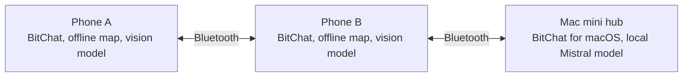

# MVP blueprint

This blueprint describes how the MVP gives people three capabilities with no internet. They can talk over a Bluetooth mesh, locate themselves on an offline map, and ask a Mistral model that runs on an offline Mac mini. It is a proposal for the team, and the decisions that are still open are listed at the end. [README.md](README.md) has the overview.

The MVP replaces [the earlier design](https://github.com/yananlong/Mistral-london-20261121/blob/145a442e4950d988264bfd06662707746da5627e/PLAN.md), in which a connected volunteer forwarded requests to the cloud Mistral API. No part of the MVP uses the internet.

## Two kinds of device share one mesh



Phone A can reach the hub through phone B when the hub is out of phone A's Bluetooth range.

| Capability | Runs on | Uses | Built from |
| --- | --- | --- | --- |
| Talk | Phones | Bluetooth | The BitChat mesh |
| Locate | Phones | Satellite positioning, the compass, the camera and downloaded map tiles | An offline map and an on-device vision model |
| Ask | The Mac mini hub, reached over the mesh | A local model and a power source | A modified BitChat for macOS build, a local inference server and an open-weight Mistral model |

## Talk: the BitChat mesh

[BitChat](https://github.com/permissionlesstech/bitchat) is a public-domain app for iOS and macOS. It sends messages over Bluetooth Low Energy and relays them through nearby devices for up to 7 hops. Its Nostr mode needs internet, so the MVP does not use it.

- We propose to fork the BitChat iOS app and add a map and an Ask screen to it. People then get all three capabilities in one app on one mesh.
- Keep mesh traffic to short text. Bluetooth packets are small, and a long message is slow over several hops. Images and audio stay off the mesh.
- If the fork cannot send messages between two of our phones within a fixed timebox (for example 4 hours), switch to Apple's Multipeer Connectivity. Multipeer also runs on macOS, so the hub can stay on the Mac mini. Multipeer has no multi-hop relay, so every phone must be in range of the hub. Keep the same message format. [PLAN.md section 5](PLAN.md#5-open-decision-how-does-the-message-move) compares the other transports.

## Ask: Mistral on an offline Mac mini

The Mac mini is the hub. Its Wi-Fi is off, its Ethernet cable is unplugged and its Bluetooth is on. It runs two programs:

- A BitChat for macOS build with one change. When a private message arrives for the hub, the build sends the text to the local inference server and replies to the sender with the answer. BitChat has no bot API, so the change goes into BitChat's source. [spcpza/bitchat-gateway](https://github.com/spcpza/bitchat-gateway) describes a BitChat peer that answers mesh users with internet AI. Read it before you write the change.
- A local inference server on `localhost`. [llama.cpp](https://github.com/ggml-org/llama.cpp) `llama-server` and [Ollama](https://ollama.com) both expose an OpenAI-compatible chat API.

Pick an open-weight Mistral model that fits in the Mac mini's memory and answers fast enough over the mesh. The candidates are the Ministral 3 models (3B, 8B and 14B, [released in December 2025](https://techcrunch.com/2025/12/02/mistral-closes-in-on-big-ai-rivals-with-mistral-3-open-weight-frontier-and-small-models)) and Mistral Small 3.2 (24B). Measure the answer time and quality of each candidate on the same test questions before you choose.

The hub answers in a fixed way:

- The hub replies "Received. Working on an answer." as soon as a question arrives. The asker then knows that the hub is in range. The answer follows in a second message.
- The system prompt asks for short numbered steps in plain language, with the most urgent action first. Short answers suit a slow link and a stressed reader.
- The hub ends every answer with "AI answer from an offline model. Not verified emergency advice." The label reaches people who use stock BitChat too.
- The model knows only its training data and the guides that we load. It has no live information about the disaster.

Start with the system prompt alone. After the round trip works, add retrieval over a curated set of survival and first-aid guides that are stored on the hub.

### Message format

Questions and answers are plain-text BitChat private messages. Plain text lets a person with stock BitChat use the hub without our app. The `loc:` line is optional, and the app adds it only when the user chooses to share their location.

A question from a phone to the hub:

```text
How do I make river water safe to drink?
loc: 51.50070,-0.12460
```

The hub's first reply:

```text
Received. Working on an answer.
```

The hub's second reply:

```text
1. Let the water settle, then pour the clear part through a cloth.
2. Bring it to a rolling boil for at least 1 minute.
...
AI answer from an offline model. Not verified emergency advice.
```

The Ask screen shows one of four states for each question:

| State | Shown when |
| --- | --- |
| **Sent** | The phone has sent the question into the mesh. |
| **Received by hub** | The hub's first reply has arrived. |
| **Answered** | The hub's second reply has arrived. |
| **Hub not reachable** | No first reply arrived within the timeout (for example 30 seconds). The user can retry. |

## Locate: an offline map and an on-device vision model

- **Offline map.** Download map tiles for the region before the disaster, for example from [OpenStreetMap](https://www.openstreetmap.org). The phone shows its position from satellite positioning, which works without internet. Without assistance data from the network, the first position fix can take longer.
- **Location sharing.** The user taps **Share location** to send their coordinates over the mesh to one person or to the public channel. The message carries the same `loc:` line as a question. The receiving phone shows a pin on its own offline map.
- **Vision model.** A teammate is investigating a computer vision model that runs on the phone and helps the user orient themselves on the offline map. The candidate approaches are below. We pick one for the MVP.
	- Read street and building signs with on-device text recognition, and match the text to labels on the map.
	- Recognize landmarks by comparing the camera image with reference photos that come with the map download.
	- Work out which way the user faces from the direction of a recognized landmark.

Test one premise before you build the vision model. Satellite positioning and the compass already give position and heading without internet. Name the case where the vision model does better, such as indoors, between tall buildings or when satellite positioning has no fix. The demo then shows that case.

## How the six survival needs map to the MVP

| Need in [IDEA.md](IDEA.md) | Capability |
| --- | --- |
| Communication | Talk |
| Navigation | Locate |
| Food, water, energy and medical | Ask |

## Demo script

The demo takes three minutes and uses phones A and B and the Mac mini.

1. Show the setup. Phones A and B are in airplane mode with Bluetooth on. The Mac mini's network settings show Wi-Fi off and no Ethernet connection.
2. Phone A sends a message to phone B over the mesh.
3. Phone A opens the map, finds its position and uses the vision model to orient itself. Phone A shares its location, and a pin appears on the map on phone B.
4. Move phone A out of the hub's direct range, so its question travels through phone B. A judge types a question on phone A. The status changes to **Received by hub** and then to **Answered**. The Mac mini's terminal shows the local model run.
5. Turn off Bluetooth on the Mac mini, and ask again. Phone A shows **Hub not reachable**. Turn Bluetooth back on and retry, and the answer arrives.

[critique.md](critique.md) lists the evidence that each run should record.

## Build order

Each step ends in a check. One or two people take steps 1 to 3. Steps 4, 5 and 6 can run in parallel with them.

1. **Mesh between two phones.** Install stock BitChat on two phones in airplane mode. The step is done when messages arrive in both directions.
2. **Local model on the Mac mini.** Run the inference server with Wi-Fi off and Ethernet unplugged. The step is done when a test question gets an answer and you have recorded the answer time for each candidate model.
3. **Hub answers over the mesh.** Build the BitChat for macOS change. The step is done when a phone with stock BitChat sends the hub a private message and gets an answer.
4. **Map and location sharing.** Fork the BitChat iOS app, and add the offline map and **Share location**. The step is done when phone B shows a pin for phone A while both phones are in airplane mode.
5. **Ask screen.** Add the Ask screen with suggested questions and the four states. The step is done when each state appears, **Hub not reachable** included.
6. **Vision model.** The teammate works on this step from the start. The step is done when the model orients the user correctly on the map in the case named under Locate.

The stretch goals come after step 6:

- Retrieval over the survival guides on the hub.
- Answers read aloud with the iOS text-to-speech API, `AVSpeechSynthesizer`.
- Answers about the nearest shelter or water source, from map data stored on the Mac mini.

## Out of scope for the MVP

- Cloud services of any kind, including the Mistral API and cloud Voxtral. [SETUP_VOXTRAL.md](SETUP_VOXTRAL.md) covers the cloud path, which can only make audio before a disaster.
- Images and audio over the mesh.
- Plant and fungus identification, because a wrong answer can poison someone.
- A connected volunteer who forwards requests to cloud Mistral. That was the earlier design.

## Open questions

- [ ] Do we fork the BitChat iOS app, or build our own app that runs beside stock BitChat?
- [ ] Which phones do we demo on? The fork runs on iOS only.
- [ ] Which Mac mini do we have, with which chip and how much memory? Memory limits the model size.
- [ ] Which model and inference server answer fast enough over two hops?
- [ ] Which vision approach do we build, and in which case does it beat satellite positioning and the compass?
- [ ] Which map region and tile source do we use for the demo?
- [ ] Which survival guides do we load on the hub, and under which licences?
- [ ] What powers the hub in a real deployment?
