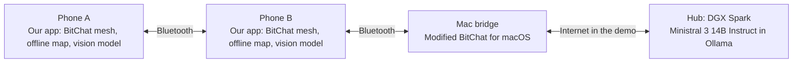

# MVP blueprint

This blueprint describes how the MVP gives people three capabilities when their phones have no signal. They can talk over a Bluetooth mesh, locate themselves on an offline map, and ask a Mistral model on a hub that they reach through the mesh. [Decisions](#decisions) records what the team has decided, and [Open questions](#open-questions) lists what is still open. [README.md](README.md) has the overview.

**The target system** is a central hub with internet access that people reach by passing messages from phone to phone. The hub answers questions with its own open-weight Mistral model, passes on live official information and sends messages to people outside the mesh. **The MVP** proves the mesh path and the answers from the hub's own model. The hub is the team's DGX Spark, a remote GPU server that runs Ministral 3 14B Instruct in Ollama. The Mac bridge, a Mac at the venue, joins the mesh and forwards each question to the hub over the internet. [From the MVP to the target hub](#from-the-mvp-to-the-target-hub) covers what the internet connection adds.

The hub replaces [the earlier design](https://github.com/yananlong/Mistral-london-20261121/blob/145a442e4950d988264bfd06662707746da5627e/PLAN.md), in which any connected volunteer's phone forwarded requests to the cloud Mistral API. The hub is a fixed, managed node that people can rely on and verify. In a real deployment, the hub sits next to the Mac bridge, so it keeps answering from its own model if its internet connection fails.

## Phones and the Mac bridge share one mesh



Phone A can reach the Mac bridge through phone B when the Mac bridge is out of phone A's Bluetooth range. The hub is not on the mesh. The Mac bridge forwards each question to it.

| Capability | Runs on | Uses | Built from |
| --- | --- | --- | --- |
| Talk | Phones | Bluetooth | The BitChat mesh, wrapped in a native module in our React Native app |
| Locate | Phones | Satellite positioning, the compass, the camera and downloaded map tiles | An offline map and an on-device vision model |
| Ask | The hub, reached over the mesh through the Mac bridge | A network link from the Mac bridge to the hub, the hub's GPU and a power source | A modified BitChat for macOS build on the Mac bridge, and Ministral 3 14B Instruct in Ollama on the hub |

## Talk: the BitChat mesh

[BitChat](https://github.com/permissionlesstech/bitchat) is a public-domain app for iOS and macOS. It sends messages over Bluetooth Low Energy and relays them through nearby devices for up to 7 hops. Its Nostr mode needs internet, so the MVP does not use it.

- We fork the BitChat iOS app for its Swift mesh code. The front end is a new React Native app, and a native module in it wraps the BitChat mesh. People get all three capabilities in one app on one mesh. The app runs on iPhone only.
- The team fork is [cole-dorrestein/bitchat](https://github.com/cole-dorrestein/bitchat), and the `bitchat/` submodule points at it. The iOS mesh changes and the Mac bridge change both go into this fork.
- Keep mesh traffic to short text. Bluetooth packets are small, and a long message is slow over several hops. Images and audio stay off the mesh.
- If the fork cannot send messages between two of our phones within a fixed timebox, switch the native module to Apple's Multipeer Connectivity. The timebox is [deferred](#deferred-questions). Multipeer also runs on macOS, so the Mac bridge can use it too. Multipeer has no multi-hop relay, so every phone must be in range of the Mac bridge. Keep the same message format. [PLAN.md section 5](PLAN.md#5-how-does-the-message-move) compares the other transports.

## Ask: Ministral 3 14B Instruct on the hub

In the MVP, the hub is the team's NVIDIA DGX Spark, a remote GPU server that runs Ministral 3 14B Instruct in Ollama. BitChat runs only on iOS and macOS, and the DGX Spark runs Linux, so the hub cannot join the mesh. The Mac bridge joins the mesh in its place. The Mac bridge is a Mac at the venue with Bluetooth on. Each question passes through two programs:

- On the Mac bridge, a BitChat for macOS build with one change. When a private message arrives for the hub, the build forwards the text to Ollama on the hub and replies to the sender with the answer. BitChat has no bot API, so the change goes into BitChat's source in the team fork. [spcpza/bitchat-gateway](https://github.com/spcpza/bitchat-gateway) describes a BitChat peer that answers mesh users with internet AI. Read it before you write the change.
- On the hub, [Ollama](https://ollama.com), which exposes an OpenAI-compatible chat API. One Ollama server with `OLLAMA_NUM_PARALLEL` set answers several questions in parallel and queues the rest.

In the demo, the Mac bridge reaches the hub over the internet, for example through Tailscale. Ministral 3 14B Instruct is open-weight ([released in December 2025](https://techcrunch.com/2025/12/02/mistral-closes-in-on-big-ai-rivals-with-mistral-3-open-weight-frontier-and-small-models)), so it can run on local hardware with no internet. In a real deployment, the hub sits next to the Mac bridge and needs no internet. No question goes to a cloud model API.

Yanan's evals own the answer time and quality thresholds, which are [deferred](#deferred-questions).

The hub answers in a fixed way:

- The Mac bridge replies "Received. Working on an answer." as soon as a question arrives, before it forwards the question to the hub. The asker then knows that the question reached the Mac bridge. The answer follows in a second message.
- The system prompt asks for short numbered steps in plain language, with the most urgent action first. Short answers suit a slow link and a stressed reader.
- The Mac bridge ends every answer with "AI answer from an open-weight model on the hub. Not verified emergency advice." The label reaches people who use stock BitChat too.
- In the MVP, the model knows only its training data and the guides that we load. It has no live information about the disaster. The target hub adds live information, each item with its source and time.

Start with the system prompt alone. After the round trip works, add retrieval over a curated set of survival and first-aid guides that are stored on the hub. [DATASETS.md](DATASETS.md#6-suggested-hackathon-shortlist) proposes a starter set and its licences.

### Message format

Questions and answers are plain-text BitChat private messages. Plain text lets a person with stock BitChat use the hub without our app. The `loc:` line is optional, and the app adds it only when the user chooses to share their location.

A question from a phone to the hub:

```text
How do I make river water safe to drink?
loc: 51.50070,-0.12460
```

The first reply, from the Mac bridge:

```text
Received. Working on an answer.
```

The second reply, with the hub's answer:

```text
1. Let the water settle, then pour the clear part through a cloth.
2. Bring it to a rolling boil for at least 1 minute.
...
AI answer from an open-weight model on the hub. Not verified emergency advice.
```

The Ask screen shows one of four states for each question:

| State | Shown when |
| --- | --- |
| **Sent** | The phone has sent the question into the mesh. |
| **Received by hub** | The first reply from the Mac bridge has arrived. |
| **Answered** | The second reply has arrived. |
| **Hub not reachable** | No first reply arrived within the timeout. The user can retry. |

To the phone, the Mac bridge is the hub's peer on the mesh, so the state names say "hub".

## Locate: an offline map and an on-device vision model

- **Offline map.** Download map tiles for London, the demo region, before the disaster, for example from [OpenStreetMap](https://www.openstreetmap.org). The phone shows its position from satellite positioning, which works without internet. Without assistance data from the network, the first position fix can take longer.
- **Location sharing.** The user taps **Share location** to send their coordinates over the mesh to one person or to the public channel. The message carries the same `loc:` line as a question. The receiving phone shows a pin on its own offline map.
- **Vision model.** A computer vision model runs on the iPhone and helps the user orient themselves on the offline map. It is smaller than the hub's model, ideally a multimodal Mistral model. Ministral 3 3B is one candidate, and [Mistral's announcement](https://mistral.ai/news/mistral-3) says it has image understanding. Martin owns the choice, and the exact model is not chosen yet. No photo crosses the mesh, and the hub's model gets text only. The candidate approaches are below. We pick one for the MVP.
	- Read street and building signs with on-device text recognition, and match the text to labels on the map.
	- Recognize landmarks by comparing the camera image with reference photos that come with the map download.
	- Work out which way the user faces from the direction of a recognized landmark.

Test one premise before you build the vision model. Satellite positioning and the compass already give position and heading without internet. Name the case where the vision model does better, such as indoors, between tall buildings or when satellite positioning has no fix. The demo then shows that case.

## From the MVP to the target hub

The hub's internet connection is what lets the system carry the information that matters most in an emergency. It carries live information and messages to people outside the mesh, never questions to a cloud model. [DATASETS.md](DATASETS.md#1-what-information-matters-most) ranks that information using evidence from past disasters and lists the sources. The connected hub adds four things:

- **Safe and well messages.** A person sends "I'm safe", with an optional location. The hub forwards it to a named contact by SMS or email and sends a delivery receipt back over the mesh. Reaching family was the top concern after the 2011 Japan earthquake, and only a connected hub can do it.
- **Live bulletins.** The hub pulls official feeds (GOV.UK Emergency Alerts, Environment Agency flood warnings, Met Office warnings, power-cut restoration times and transport status). It condenses them into short bulletins, each with its source and time, and posts them to the public mesh channel. Phones keep and re-share them, so one fetch serves the whole area. Met Office warnings are passed on word for word.
- **Service status.** The hub reports which pharmacies, A&E departments, rest centres and water stations are open, on top of the locations that phones already hold offline.
- **Priority for urgent traffic.** Alerts go first, then safe and well messages, then requests for help, then answers, then news.

If the hub loses its own connection, it keeps answering from its local model and guides, and it serves the last bulletins with their age, for example "EA flood warnings as of 09:40, 3 h ago".

The MVP leaves all four out. If the demo shows any of them, it uses recorded feeds or a simulated delivery, and the pitch says so. [critique.md](critique.md) explains why each claim must match the arrangement that is actually shown.

## How the six survival needs map to the MVP

| Need in [IDEA.md](IDEA.md) | Capability |
| --- | --- |
| Communication | Talk, plus safe and well messages through the target hub |
| Navigation | Locate |
| Food, water, energy and medical | Ask, plus live service status through the target hub |

## Demo script

The demo takes three minutes. It uses two iPhones, phone A and phone B, the Mac bridge at the venue and the hub, which is the team's remote DGX Spark.

1. Show the setup. Phones A and B are in airplane mode with Bluetooth on. Say that the Mac bridge reaches the hub over the internet and that no question goes to a cloud model API. Open the Ollama log on the hub.
2. Phone A sends a message to phone B over the mesh.
3. Phone A opens the map, finds its position and uses the vision model to orient itself. Phone A shares its location, and a pin appears on the map on phone B.
4. Move phone A out of the Mac bridge's direct range, so its question travels through phone B. A judge types a question on phone A. The status changes to **Received by hub** and then to **Answered**. The Ollama log on the hub shows the model run.
5. Turn off Bluetooth on the Mac bridge, and ask again. Phone A shows **Hub not reachable**. Turn Bluetooth back on and retry, and the answer arrives.

The proof on stage is both iPhones in airplane mode and the Ollama log on the hub for each run. [critique.md](critique.md) lists the evidence that each run should record.

## Build order

Each step ends in a check. Martin owns steps 2 and 6. Qubula owns the React Native front end in steps 4 and 5. Steps 4, 5 and 6 can run in parallel with steps 1 to 3.

1. **Mesh between two phones.** Install stock BitChat on two iPhones in airplane mode. The step is done when messages arrive in both directions.
2. **Local model on the DGX Spark.** Run Ministral 3 14B Instruct in Ollama on the hub, with `OLLAMA_NUM_PARALLEL` set. The step is done when a test question gets an answer and you have recorded the answer time.
3. **Mac bridge forwards to the DGX Spark.** Build the BitChat for macOS change in the team fork, and run it on the Mac bridge. The step is done when a phone with stock BitChat sends the hub a private message and gets an answer through the Mac bridge, and the Ollama log on the hub shows the run.
4. **Map and location sharing.** Build the React Native app with a native module that wraps the mesh code from the team fork. Add the offline map of London and **Share location**. The step is done when phone B shows a pin for phone A while both phones are in airplane mode.
5. **Ask screen.** Add the Ask screen with suggested questions and the four states. The step is done when each state appears, **Hub not reachable** included.
6. **Vision model.** Martin works on this step from the start. The step is done when the model orients the user correctly on the map in the case named under Locate.

The stretch goals come after step 6:

- Retrieval over the survival guides on the hub.
- Answers read aloud with the iOS text-to-speech API, `AVSpeechSynthesizer`.
- Answers about the nearest shelter or water source, from map data stored on the hub.
- A safe and well message that reaches a contact outside the mesh, with a delivery receipt back to the sender.
- One live bulletin, from a live feed or a recorded one. The pitch says which.

## Out of scope for the MVP

- Cloud model APIs of any kind, including the Mistral API and cloud Voxtral. [SETUP_VOXTRAL.md](SETUP_VOXTRAL.md) and `voxtral/tts.py` cover the cloud path, which can only make audio before a disaster.
- Images and audio over the mesh.
- Plant and fungus identification, because a wrong answer can poison someone.
- Any connected volunteer's phone acting as the gateway. That was the earlier design, and the target system uses a fixed hub instead.
- Android phones. The app runs on iPhone only.

## Decisions

The team made these decisions on 2026-11-21. Each one names its owner where the team has chosen one.

- **Phone app.** We fork the BitChat iOS app for its Swift mesh code. The front end is a new React Native app, and a native module in it wraps the BitChat mesh. The app runs on iPhone only, and the demo uses 2 iPhones. Qubula owns the React Native front end.
- **BitChat fork.** The team fork is [cole-dorrestein/bitchat](https://github.com/cole-dorrestein/bitchat), and the `bitchat/` submodule points at it. The iOS mesh changes and the Mac bridge change go into this fork.
- **Hub.** The hub is the team's NVIDIA DGX Spark, a remote GPU server. Ollama on the hub serves Ministral 3 14B Instruct. Martin owns the hub.
- **Mac bridge.** BitChat runs only on iOS and macOS, and the DGX Spark runs Linux. The Mac bridge is a Mac at the venue that joins the mesh with the modified BitChat for macOS build. It forwards each question to Ollama on the hub over the internet, for example through Tailscale.
- **Open-weight models only.** The model on the hub is open-weight, so it can run on local hardware with no internet. No question goes to a cloud model API. In the demo, the phones have no internet, and the Mac bridge reaches the hub over the network. Do not call the demo hub offline. In a real deployment, the hub sits next to the Mac bridge and needs no internet. The proof on stage is both iPhones in airplane mode and the Ollama log on the hub for each run.
- **Vision on the phone.** The vision model for Locate runs on the iPhone. It is smaller than the hub's model, ideally a multimodal Mistral model such as Ministral 3 3B. The exact model is not chosen yet, and Martin owns the choice. The hub's model gets text only, and no photo crosses the mesh.
- **Map region.** The demo map covers London.
- **Concurrency.** One Ollama server with `OLLAMA_NUM_PARALLEL` set answers several questions in parallel and queues the rest.
- **Deferred.** The time targets, the timeout, the maximum answer length, the BitChat timebox, the vision accuracy measure, the test question set, the answer rubric and hub identity verification stay open. Yanan owns the evals, and the evals own the thresholds. [Deferred questions](#deferred-questions) lists each one.

## Open questions

- [ ] Which small multimodal Mistral model runs fast enough on the iPhone for Locate? Martin owns the choice.
- [ ] Which vision approach do we build, and in which case does it beat satellite positioning and the compass?
- [ ] Which tile source do we use for the London map?
- [ ] Which survival guides do we load on the hub, and under which licences? [DATASETS.md](DATASETS.md) has a proposal.
- [ ] Does the demo show any of the target hub's online features, with recorded data or a live connection?
- [ ] In a real deployment, the hub sits next to the Mac bridge. What powers them, and what keeps the hub connected for live information when local networks fail (for example satellite, or a building with backup power and fibre)?

### Deferred questions

The team deferred these questions on 2026-11-21. Yanan's evals own the thresholds.

- [ ] What are the time targets for the first reply and for the answer?
- [ ] How long does the phone wait for the first reply before it shows **Hub not reachable**?
- [ ] What is the maximum answer length?
- [ ] How long is the BitChat timebox before we switch to Multipeer?
- [ ] How do we measure the accuracy of the vision model?
- [ ] Which test questions do the evals use?
- [ ] Which rubric scores the answers?
- [ ] How do people verify that they are talking to the real hub?
